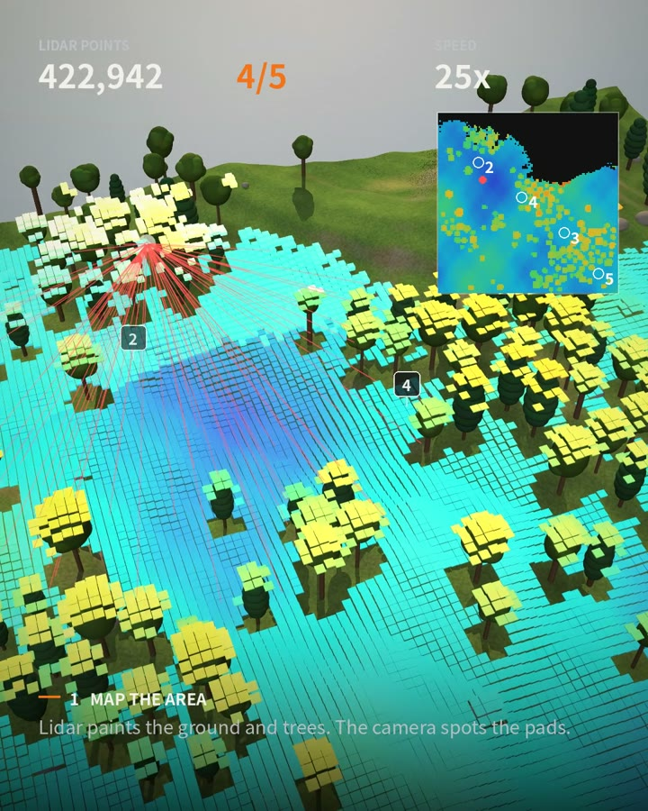
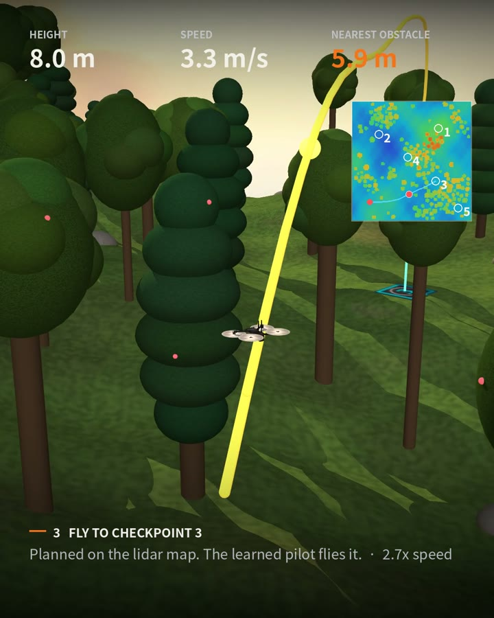

# Drone that maps a forest and flies itself to any checkpoint

A Skydio X2 quadcopter in MuJoCo maps 120 × 120 m of hills and forest with lidar, finds five numbered landing pads with its camera, then flies to whichever checkpoint you type and lands on it. The flying is done by a pilot trained with reinforcement learning (PPO).

<p align="center"> </p>

**Video:** [`video/drone_lidar_nav.mp4`](video/drone_lidar_nav.mp4) (36 s, 4:5)

## Results

| | |
|---|---|
| Pilot training | PPO, 377 M simulated steps, 19 min on 2 GPUs |
| Landings in training (random forests) | 95 % |
| Test flights (2 full runs × 7 flights) | 14 / 14 landed safely, 5–51 cm from the pad centre |
| What the pilot sees | 154 lidar beams, its motion sensors and the next route points |

## How it works

1. **Map.** A lawn-mower flight at 24 m. A downward lidar builds a 2.5D map (surface height, bare ground under the trees, obstacle height). The down camera spots the coloured pads.
2. **Plan.** A* on the map with two flight levels: 3.5 m above the ground weaving between trees, or 4 m above the canopy when there is no way through.
3. **Fly.** The learned pilot sends thrust and rotation rates to a standard flight controller. It avoids obstacles itself and does the landing. The camera only finds and confirms the pads; it does not steer.

## Run it

```bash
python3 -m venv .venv && .venv/bin/pip install -r requirements.txt
.venv/bin/mjpython live.py                  # maps the area first (about 40 s at 5x), then waits
.venv/bin/mjpython live.py --use-saved-map  # skip the mapping flight
```

On Linux and Windows use `python` instead of `mjpython`. Then type in the terminal:

| Key | Action |
|---|---|
| `1` … `5` | fly to that checkpoint and land |
| `h` | fly home |
| `m` | map the area again |
| `r` | reset at home (after a crash) |
| `c` | show / hide the lidar map cloud |
| `q` | quit |

The window shows the route (cyan = between the trees, orange = over the treetops), the yellow "carrot" point the pilot is chasing, red dots where its lidar touches something, a mini-map and the down camera.

## Repository

| File | Contents |
|---|---|
| `live.py` | the interactive window |
| `mission.py` | mapping, planning and flying a mission |
| `flight.py` | drone, sensors and the learned pilot |
| `mapper.py`, `planner.py` | 2.5D lidar map and A* route planner |
| `common.py` | drone dynamics and observations, shared with the GPU training environment |
| `pilot.npz` | the trained pilot network |
| `saved_map.npz` | a finished lidar map, to skip the mapping flight |
| `scene/` | the generated world: terrain, trees, rocks and pads |
| `drone_env.py` | the training environment (JAX/MJX): random forests on hilly ground, lidar, routes, landing |
| `train_drone.py` | PPO training (Brax) on all visible GPUs, 8,192 parallel worlds |
| `export_policy.py` | checkpoint → `pilot.npz` for the live app |
| `test_env.py`, `rollout_train.py`, `crash_causes.py` | checks, rollouts in training worlds, failure analysis |
| `world_demo.py` | builds the fixed demo world in `scene/` |
| `record_demo.py`, `video_drone.py`, `train_worlds.py`, `render_drone.sh` | the video |
| `runs/pilot2/` | training settings, curve and log |

Training ran to 608 M steps; the pilot in `pilot.npz` is the 377 M-step checkpoint, the one with the highest success rate (94.9 %). Later checkpoints did not improve.

```bash
python train_drone.py --name pilot2 --steps 600e6 --evals 30        # needs JAX with CUDA
JAX_PLATFORMS=cpu python export_policy.py runs/pilot2/ckpt/step_000377487360.pkl pilot.npz
```

## Credits

- Drone model: Skydio X2 from [MuJoCo Menagerie](https://github.com/google-deepmind/mujoco_menagerie), Google DeepMind, Apache-2.0 (licence in `scene/assets/`). Two of its propellers spin the wrong way in the original model; they are corrected in this copy.
- Terrain, trees, rocks and pad textures are generated by code.
- Simulation, training, mapping, planning and video: Kishan Chhari.
